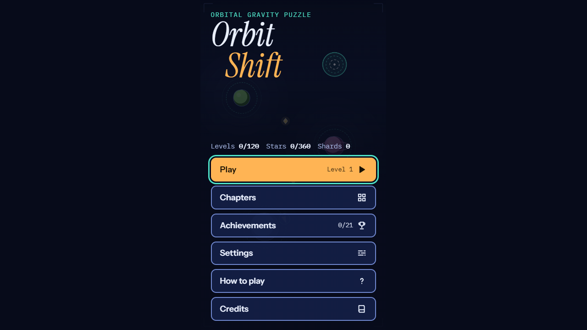
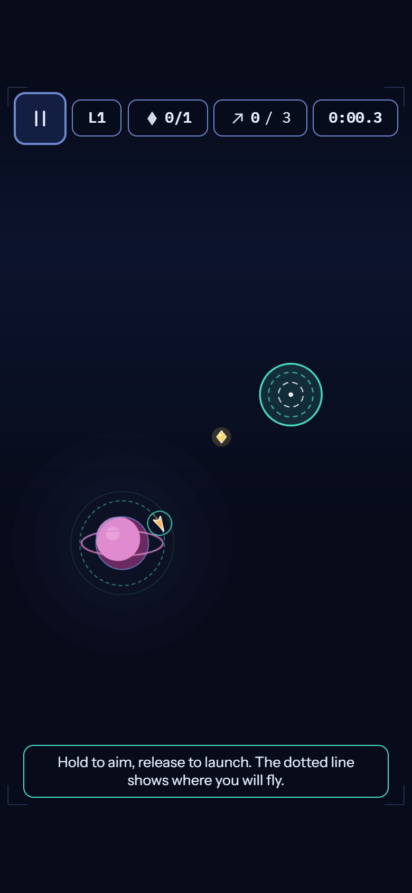
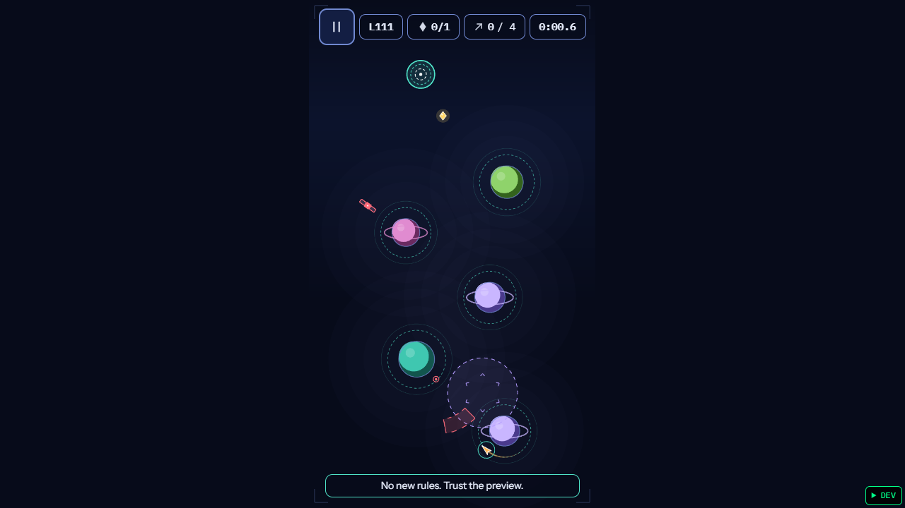
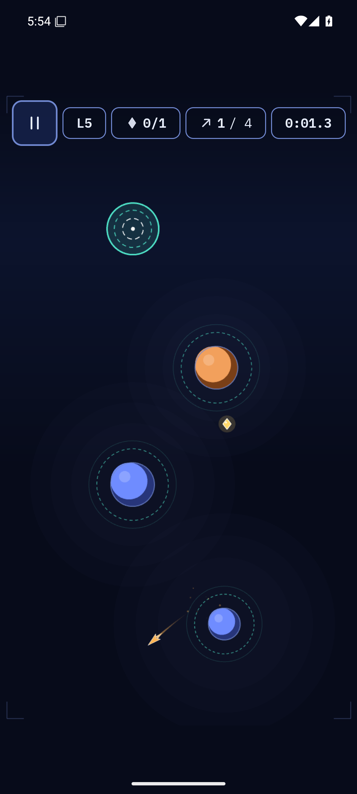
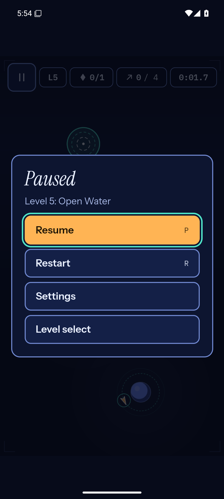
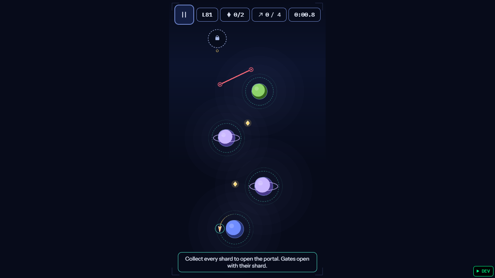
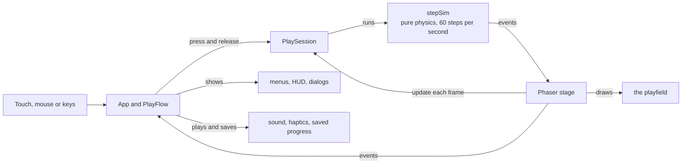

# Orbit Shift

A one-touch orbital gravity puzzle arcade game: **120 levels in 12 chapters**, playable in the browser and as an
**offline Android app**, from one shared codebase. Hold to see exactly where you will fly, release to launch, and use
planetary gravity to reach the portal while avoiding hazards.

Version **1.0.0** · Android package `com.portfolio.orbitshift` · Phaser 3.90 · TypeScript · Vite · Capacitor 8

| | | |
|:-:|:-:|:-:|
|  |  |  |
|  |  |  |

The two Android screenshots come from an Android 15 **emulator**, not a phone.

## What has and has not been verified

Read this first. Claims are limited to what was actually run.

| Area | Status |
|---|---|
| Unit and integration tests | 278 passing. Coverage 97.3% statements, 90.7% branches, 97.8% functions, 99.4% lines. |
| Lint, typecheck, production build | Clean (limits enforced: 120-char lines, complexity 10, nesting 3, 4 parameters, file size). |
| 120 levels: structure and a winning route | **Automated:** all 120 pass schema, geometry and clearance checks, and a recorded route replays to three stars, both in Node and in the running browser game. |
| 120 levels: played by a person | **0 of 120.** Automated replay proves a winning route exists; it does not prove a level is fun, fair or readable. See `docs/LEVEL_QA.md` and `qa/manual-playthroughs.json`. |
| Browser (Edge 156) | 30 Playwright checks pass on the dev server, 20 on the production build (real mouse and touch input, axe WCAG 2.2 AA on every screen, phone layouts, 44 px targets, persistence, no-network play). |
| Android APK | Built, installed and exercised on an **emulator** (12 checks pass: device-level tap/hold, back and Home, progress surviving a process kill, airplane mode, in-place update). |
| A real Samsung Galaxy | **Not tested.** No physical phone was available. Touch feel, audio on a phone speaker, notches and real performance are unverified. |
| Performance | **No 60 FPS claim.** On the emulator's software graphics the game ran at 17-29 fps, which says nothing about a phone's GPU. The simulation is frame-rate independent by design (fixed 60 Hz steps), so a slow device plays at the right speed, just less smoothly. |
| GitHub CI workflow | Written, never run. |

Re-run on 2026-11-05: typecheck, lint, `npm run levels:check` (all 120 pass) and `npm run test:coverage` (278 tests in 15
files, coverage unchanged from the figures above). The Playwright and Android rows were **not** re-run on that date; they
carry the results recorded in [FEATURE_LOG.md](FEATURE_LOG.md) on 2026-11-03.

## Play it in the browser

```bash
npm install
npm run dev        # http://localhost:5610  (SkyHop uses 5605; this one is separate)
```

Production build: `npm run build` then `npm run preview` (also port 5610).

### Controls

| | Touch / mouse | Keyboard |
|---|---|---|
| Aim | Press and hold anywhere on the playfield (a dotted projected path appears) | Hold Space |
| Launch | Release | Release Space |
| Pause / back | Pause button, Android back | P or Escape |
| Restart | Pause menu | R |
| Mute | Settings | M |

**Tap-to-aim mode** (Settings > Controls > "Tap twice"): tap once to aim, tap again to launch.

## Build the Android APK

Requirements: **JDK 21+** and the **Android SDK** (platforms and build-tools). Set `ANDROID_HOME` to the SDK folder.
The build script also looks for JDK 21 on `PATH` and in the usual install folders, so a mismatched `JAVA_HOME` is
tolerated.

```bash
npm run android:apk:debug
```

In order, it: validates the 120 levels and builds the latest web bundle (`npm run build`), copies it into the Android
project (`cap sync android`), runs Gradle `assembleDebug`, then checks the APK exists, is not empty and carries the
expected package id and version, and prints the real output path. It never packages stale assets because the web build is
step one.

Output (verified, not assumed):

- `android/app/build/outputs/apk/debug/app-debug.apk`
- `artifacts/OrbitShift-1.0.0-debug.apk` and a `.sha256` file next to it (git-ignored)

APK facts read back with `aapt2`: package `com.portfolio.orbitshift`, versionName `1.0.0`, versionCode `10000`,
**minSdk 24 (Android 7.0)**, targetSdk 36, portrait only, **no INTERNET permission** (the only permission is `VIBRATE`
for haptics). The game files are inside the APK: it loads from `https://localhost/` served by the app itself, never a
remote page, and works in airplane mode.

### Install on a Samsung Galaxy

1. Copy `artifacts/OrbitShift-1.0.0-debug.apk` to the phone (USB, cloud drive, or similar).
2. On the phone open it from **My Files**. When asked, allow **Install unknown apps** for that file manager or browser.
3. Tap **Install**. If Google Play Protect offers to scan the app, that is expected for a sideloaded debug build.

Or with USB debugging on: `adb install -r artifacts/OrbitShift-1.0.0-debug.apk`.

- `-r` updates in place and **keeps saved progress**, as long as the new APK is signed with the same key. This is a
  **debug-signed** build (Android's debug key). If you ever switch to a differently signed build (for example a release
  key), Android will refuse the update, and uninstalling first **deletes the saved progress**.
- The app has no release/Play Store signing; that was not requested and is not configured.

### Check it on a device or emulator

```bash
ORBIT_ADB_SERIAL=emulator-5562 npm run android:verify   # PowerShell: $env:ORBIT_ADB_SERIAL='emulator-5562'
```

`ORBIT_ADB_SERIAL` is required so the script can never touch some other connected device. It attaches to the debug app's
WebView and also sends real device input (taps, a held touch, back, Home, airplane mode).

## The game

Your ship circles a planet on a dashed **safe lane** (nothing can hurt you there). Hold to see a projected path, release
to leave along the tangent with an outward push. Gravity bends the flight; a planet captures you when you pass its
capture ring slowly enough. Reach the portal to clear the level.

**Stars:** 1 for clearing, 2 for staying within the par launches, 3 for par launches and par time. Time is game time, so
pausing never costs a star.

**Mechanics, each shown by shape as well as colour:** stationary asteroids, orbiting satellites, rotating laser arcs
(dashed warning, solid when firing), moving planets, gravity-inversion zones, repulsion pulses, wormhole pairs, and shield
gates opened by shards (a padlocked portal shows how many shards it still needs).

| Ch. | Name | New idea |
|--:|---|---|
| 1 | First Orbit | Launch, capture, portal |
| 2 | Twin Suns | Several wells, choosing routes (asteroids from level 5) |
| 3 | Satellite Alley | Orbiting hazards and timing |
| 4 | Laser Observatory | Warning phase, rotating beams |
| 5 | Wandering Worlds | Moving planets |
| 6 | Reverse Gravity | Inversion zones |
| 7 | Pulse Fields | Repulsion timing |
| 8 | Folded Space | Wormholes |
| 9 | Locked Constellations | Shards and gates |
| 10 | Orbital Machines | Mixed hazards |
| 11 | Starship Trials | Longer, efficient routes |
| 12 | Event Horizon | Everything at once |

Also: a tutorial hint on the first level of each chapter (and on level 2), 21 achievements, per-level best
stars/time/launches, "Continue" from the first unfinished level, settings for music, sound, mute, haptics, reduced motion,
high contrast and control mode, and a confirmed "Reset progress". Levels unlock one at a time: level *n* opens when levels
1 to *n-1* are cleared.

### Accessibility

Real DOM controls with keyboard support, a focus trap and `inert` background in dialogs, a polite live region for state
changes, labelled controls, no information carried by colour alone, a high-contrast palette, reduced motion (also honours
the system preference), 44 px minimum targets, and layouts that hold from 320 px wide. axe-core finds no WCAG 2.2 AA
violations on any screen. A canvas game cannot be played by screen reader; the menus, results and announcements work with
one, but the flight itself is visual.

## How it works

One codebase runs in the browser and, packaged by Capacitor, inside an offline Android WebView.



- **The simulation is pure and deterministic.** Time is a whole number of 1/60 s ticks, and it touches no screen, DOM or
  clock. The aiming preview runs the same step function forward, so it cannot disagree with the real flight.
- **Menus are DOM, the playfield is canvas.** A canvas has no keyboard focus or screen-reader tree, so Phaser draws only the
  playfield and everything you read or press is real HTML.
- **Levels are data, checked on every build.** A seeded generator composed them and a solver proved each has a replayable
  winning route; `npm run build` replays all 120.

The full walkthrough, with 26 diagrams covering the physics step, input, navigation, saves, the level generator and solver,
and the Android build, is in **[docs/ARCHITECTURE.md](docs/ARCHITECTURE.md)**.

### Project layout

| Path | Contents |
|---|---|
| `src/game` | The pure game: simulation, level data and validators, play session, achievements |
| `src/app` | `App` (routes), `PlayFlow` (one level at a time), dialogs, keys, services |
| `src/ui` | DOM screens, HUD, dialogs, palette and styles |
| `src/phaser` | The Phaser canvas: the stage scene and drawing routines |
| `src/storage`, `src/audio`, `src/platform` | Saves, synthesised sound, haptics and app lifecycle |
| `scripts` | Level generator and checks, the APK build, icon rendering |
| `tests` | Vitest tests, Playwright browser checks (`tests/e2e`), Android device checks (`tests/android`) |
| `android` | The committed Capacitor Android project |
| `docs` | Architecture, decision record, design research, level QA manifest, screenshots |

## Levels

The 120 levels are typed data in `src/game/levels/data/chapter-NN.ts`. They were **composed by a seeded generator**
(`scripts/levels/generator`) and kept only when a solver found a replayable winning route with timing windows of at least
5 ticks (83 ms), the hazards changed that route, and the layout was not a near-copy of another level. They are not
hand-designed. Every level stores its recorded route (`solution.launchTicks`), so anyone can replay it.

```bash
npm run levels:check      # audit all 120 (also runs inside `npm run build`)
npm run levels:generate   # rebuild the catalogue from the recipes (slow: about 15 minutes)
npm run levels:qa         # rewrite docs/LEVEL_QA.md
```

Record a person's play-through in `qa/manual-playthroughs.json`, for example
`{"7": {"status": "passed", "tester": "Name", "device": "Galaxy S23", "date": "2026-11-10", "notes": "ok"}}`.
`npm run levels:check` reports how many are recorded.

## Commands

| Command | Purpose |
|---|---|
| `npm run dev` / `build` / `preview` | Dev server, production build, preview |
| `npm run typecheck` / `lint` | `tsc --noEmit` / ESLint with the size and complexity limits |
| `npm test` / `npm run test:coverage` | Vitest (node + jsdom) / with the 90% gate |
| `npm run test:e2e` | Playwright against `ORBIT_URL` (default `http://localhost:5610`); needs Edge or Chrome installed. `ORBIT_PROD=1` for a production build |
| `npm run android:icons` | Re-render launcher icons and splash images from `scripts/orbit-art.mjs` |
| `npm run android:apk:debug` | The one-command APK build |
| `npm run android:verify` | Device checks (needs `ORBIT_ADB_SERIAL`) |

## Troubleshooting

- **`No JDK 21 found`**: install JDK 21 and set `JAVA_HOME` to it.
- **`No Android SDK found`**: set `ANDROID_HOME` to the folder that contains `platforms` (the script writes
  `android/local.properties` for you; it is git-ignored).
- **Port 5610 busy**: it is a strict port. Stop what is using it, or edit `PORT` in `vite.config.ts`.
- **Gradle complains about the Java version**: it needs 21; a JDK 17 `JAVA_HOME` is overridden by the script when a 21 is found.
- **The `Capacitor/Console: [object Object]` lines in `adb logcat`** are Capacitor's own debug logging of native plugin
  calls in debug builds; they are not errors.
- **Blank white bars on Android**: already handled in the theme; rebuild if you changed `styles.xml`.

## Known limitations

- Not tested on a physical phone; no performance numbers beyond an emulator.
- No human has played the levels; difficulty and fun are unproven (see the QA manifest).
- Generated layouts can look regular compared with hand-crafted ones.
- Sound is synthesised and has not been heard on a phone speaker by the author.
- The web build needs to be loaded once; it has no service worker, so reloading it while offline needs the server. The APK
  is fully offline.
- The APK is debug-signed. There is no release signing, no `.aab`, no Play Store listing.
- Recorded solutions were verified on V8 (Node, Chrome, Android WebView), not on Safari's engine.
- ESLint 9 prints a "no longer supported" notice during install; the lint rules and results are unaffected.

## Licences and credits

Original code, level layouts, artwork and sound design. Third-party: Phaser (MIT), Capacitor (MIT), Vite, Vitest,
TypeScript, zod (dev only), Playwright and axe-core (test tooling only); Instrument Serif, Instrument Sans and IBM Plex
Mono (SIL OFL 1.1, bundled locally). The in-game Credits screen lists the runtime ones.

## Documentation

| Document | What it is for |
|---|---|
| [docs/ARCHITECTURE.md](docs/ARCHITECTURE.md) | How the whole app works, with flow charts: the simulation, input, navigation, rendering, saves, level pipeline, Android build, tests, and recipes for making changes |
| [docs/ADR-0001-stack-and-design.md](docs/ADR-0001-stack-and-design.md) | The stack and design decisions, with the alternatives that were rejected |
| [docs/DESIGN-REFERENCES.md](docs/DESIGN-REFERENCES.md) | The design research log, including where it fell short |
| [docs/LEVEL_QA.md](docs/LEVEL_QA.md) | One row per level: automated results and the "played by a person" column |
| [FEATURE_LOG.md](FEATURE_LOG.md) | Dated record of changes and exactly what was validated |
