# Orbit Shift: architecture and how it works

A guided tour of the whole app, from one frame of physics to the Android package. It is written so that someone who has
never opened the repository can understand how it fits together, and so that a contributor knows where to make a change.

Applies to version **1.0.0**. Every fact below was checked against the source on 2026-11-05. Where a number comes from a
command, the command is named, so it can be re-run.

## Contents

1. [The app in one page](#1-the-app-in-one-page)
2. [System map and dependency rules](#2-system-map-and-dependency-rules)
3. [Boot sequence](#3-boot-sequence)
4. [The simulation (the heart of the game)](#4-the-simulation-the-heart-of-the-game)
5. [A play session and the input state machine](#5-a-play-session-and-the-input-state-machine)
6. [The application layer: routes, play flow, dialogs, keys](#6-the-application-layer-routes-play-flow-dialogs-keys)
7. [Rendering: Phaser canvas plus a DOM overlay](#7-rendering-phaser-canvas-plus-a-dom-overlay)
8. [Storage: saves, settings, progress](#8-storage-saves-settings-progress)
9. [Audio and haptics](#9-audio-and-haptics)
10. [Levels: data, generator, solver, audit](#10-levels-data-generator-solver-audit)
11. [Android](#11-android)
12. [Quality system: tests, lint, CI](#12-quality-system-tests-lint-ci)
13. [How it was built, and why](#13-how-it-was-built-and-why)
14. [Making changes: recipes](#14-making-changes-recipes)
15. [Limits of what has been verified](#15-limits-of-what-has-been-verified)
16. [Glossary](#16-glossary)

---

## 1. The app in one page

**Orbit Shift** is a one-touch orbital gravity puzzle game with 120 levels in 12 chapters. Your ship circles a planet on a
dashed "safe lane". You hold to see a dotted path that shows exactly where you would fly, and release to launch. Gravity
bends the flight. If you pass close to a planet slowly enough, it captures you and you orbit it. Reach the portal to clear
the level.

It ships two ways from **one codebase**: a web page, and an offline Android app that loads the same JavaScript bundle
inside a WebView.

### Five ideas that explain most of the design

| Idea | What it means | Where it lives |
|---|---|---|
| **The simulation is pure and deterministic** | Time is a whole number of 1/60 s ticks. Every moving thing is a function of the tick. Nothing in it touches the screen, the DOM or the clock. | `src/game/simulation` |
| **The preview is the real physics** | The dotted aiming path is produced by running the same step function forward, so it cannot disagree with the actual flight. | `src/game/simulation/flight.ts` |
| **Menus are DOM, the playfield is canvas** | A canvas has no keyboard focus, no screen-reader tree and no text zoom. So Phaser draws only the playfield and everything you read or press is real HTML. | `src/ui`, `src/phaser` |
| **Levels are data, proven by a solver** | The 120 levels are typed data produced by a seeded generator and accepted only when a solver finds a replayable winning route. Every build replays all 120. | `scripts/levels`, `src/game/levels` |
| **Claims are limited to what was run** | The repository separates "automated checks pass" from "a person played it" and from "tested on a real phone". | README, `docs/LEVEL_QA.md` |

### Size, measured on 2026-11-05

- About **6,300 lines** of hand-written TypeScript in **71 files** under `src` (`find src -name '*.ts'`, excluding level data).
- About **15,200 lines** of generated level data in 12 files, `src/game/levels/data/chapter-01.ts` to `chapter-12.ts`.
- Runtime dependencies: Phaser 3.90.0 (pinned), Capacitor 8 (core, app, haptics) and three bundled font packages.
  `zod`, Vitest, Playwright and axe-core are development-only.

---

## 2. System map and dependency rules

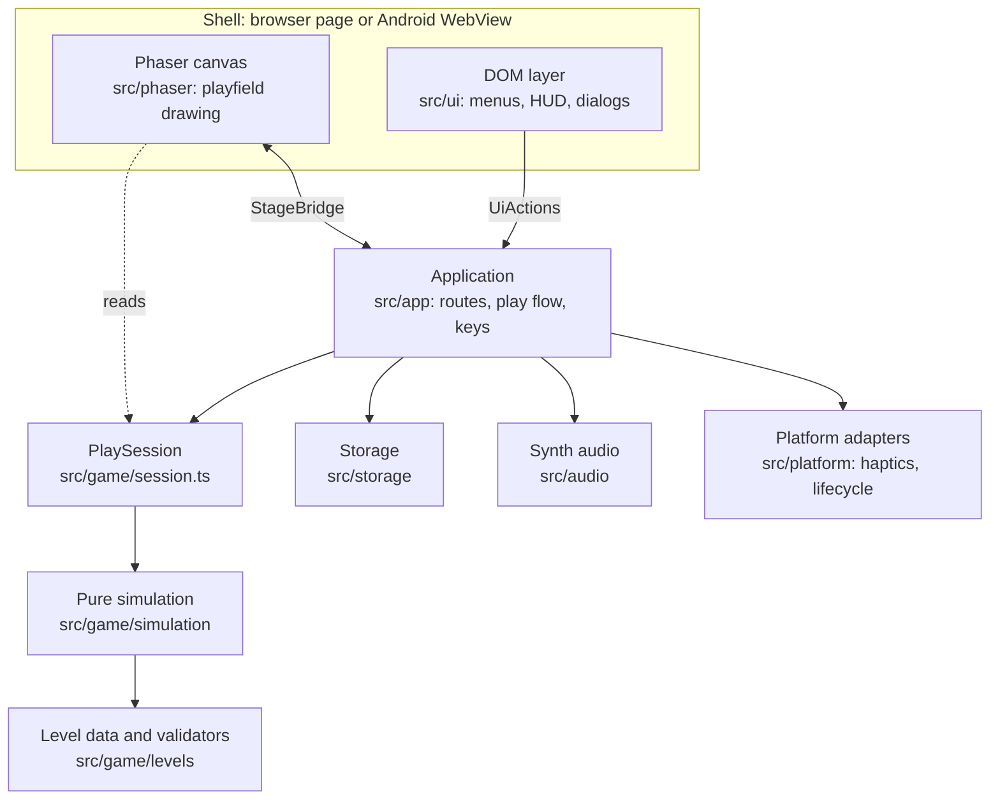

`src/phaser` and `src/ui` never call each other. The Phaser stage reads the live `PlaySession` through a plain
`StageBridge` object and reports events back through it. The DOM layer calls `UiActions` on `App`.

### Which folder may import which

This is measured from the actual `import` lines, not intended. A dotted arrow means a narrow use.

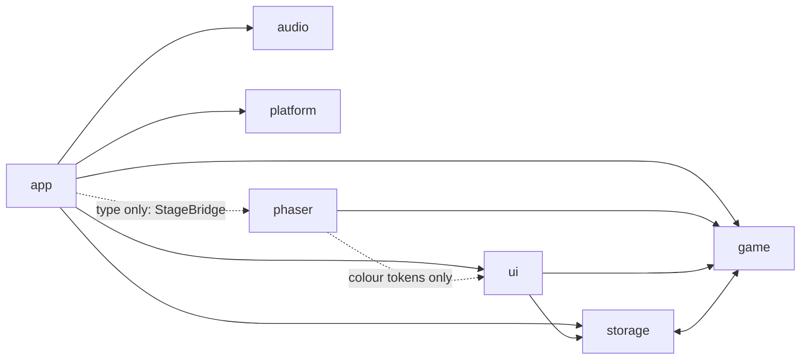

- `audio` and `platform` import nothing from the other layers. They are leaves.
- Only five files, all in `src/phaser`, import the Phaser library. Neither the simulation nor `App` does.
- `src/game` imports no DOM, `localStorage`, wall-clock or animation-frame API. Its one `Math.random` is a default
  argument of the particle pool, which tests replace with a fixed function.
- `game` and `storage` depend on each other at folder level: `game/achievements.ts` reads the progress model, and
  `storage/progress.ts` calls `newlyEarned`. At file level the chain is acyclic.

Because neither `App` nor the simulation imports Phaser, the whole play flow is unit-tested under jsdom with fakes.

### Directory guide

| Path | Contents |
|---|---|
| `src/game/simulation` | Constants, motion, forces, collisions, encounters, `stepSim`, prediction and replay, fixed-step timer, ship interpolation |
| `src/game/levels` | Level types, chapter table, validator, runtime schema (zod), fingerprints, audit, star rules, the 120-level data |
| `src/game/tools/solver.ts` | The release-tick solver. Used by the generator and tests, not by the running game |
| `src/game/session.ts` | One attempt: aim and launch state machine, pause, restart, stars |
| `src/game/achievements.ts`, `tips.ts`, `particles.ts` | 21 achievements, per-death tips, the fixed-size particle pool |
| `src/storage` | Store adapter, versioned `SaveSlot` with a backup, settings, progress |
| `src/audio` | Web Audio engine, synthesised effects, generative music |
| `src/platform` | Haptics and app lifecycle: Capacitor on Android, web fallbacks |
| `src/app` | `App`, `PlayFlow`, dialog stack, key handling, canvas tracking, services, dev inspector |
| `src/ui` | DOM screens, HUD, dialogs, palette, icons, stylesheet |
| `src/phaser` | The Phaser game, the single stage scene, drawing routines, particles, starfield |
| `scripts/levels` | Generator, check and QA-manifest scripts |
| `scripts/build-apk.mjs` | The one-command APK pipeline |
| `tests` | Vitest tests (node and jsdom), `tests/e2e` Playwright, `tests/android` device checks |
| `android` | The generated and committed Capacitor project (icons, theme, manifest, Gradle) |
| `docs` | This file, the ADR, design research log, level QA manifest, screenshots |

---

## 3. Boot sequence

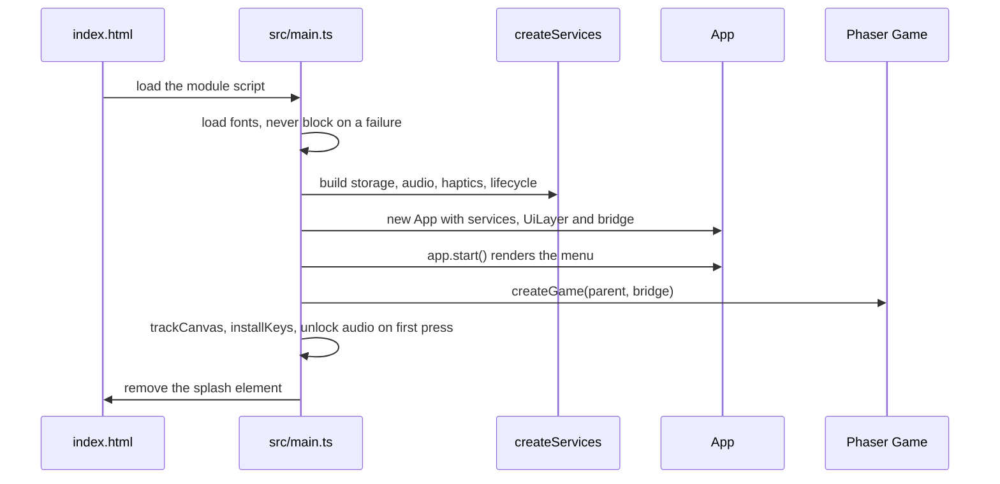

Details worth knowing:

- `index.html` paints the page background and a text splash **before** any script runs, so the first frame already has the
  game's colours. The splash is removed at the end of `boot()`. If `boot()` throws, the splash shows the error text.
- `createServices` builds everything the app depends on once (`Services`): settings, progress, audio engine, sound
  effects, music, haptics, lifecycle, and an `exit` callback. Tests build the same shape from fakes.
- If `localStorage` is blocked, `createDefaultStore` falls back to an in-memory store. The game still plays and a toast
  says progress will not be saved.
- In development only, `main.ts` also imports `app/dev.ts` behind `import.meta.env.DEV`. That file installs the
  `window.__orbit` hook used by the browser tests and does not exist in a production build or in the APK.

---

## 4. The simulation (the heart of the game)

All of this is in `src/game/simulation`. It has no Phaser, DOM or clock dependency.

### 4.1 World, units and tuned constants

The playfield is a fixed portrait rectangle of **720 x 1280 world units**. Every device scales this rectangle to fit, so a
phone, a tablet and a desktop window all play the same level. Time is measured in **ticks** (60 per second).

| Constant | Value | Meaning |
|---|---:|---|
| `TICK_RATE` | 60 | Simulation steps per second of game time |
| `MAX_CATCHUP_STEPS` | 5 | After a long stall, run at most 5 steps (about 83 ms) and slow down instead of spiralling |
| `SHIP_HIT_RADIUS` | 7 | The ship's collision radius |
| `ORBIT_GAP` | 28 | Distance between a planet's surface and the ship's lane |
| `CAPTURE_MARGIN` | 16 | A planet captures within its lane radius plus this |
| `CAPTURE_SPEED_MAX` | 470 | Fastest relative speed a planet can capture |
| `MAX_SPEED` | 540 | Speed clamp during flight |
| `LAUNCH_SPEED` | 340 | Launch speed |
| `LAUNCH_RADIAL` | 0.34 | Outward push mixed into the tangent launch direction |
| `RECAPTURE_LOCKOUT` | 36 ticks | The planet you just left cannot recapture you for 0.6 s |
| `WORMHOLE_COOLDOWN` | 24 ticks | A wormhole ignores a ship that just came out of one for 0.4 s |
| `FLIGHT_TIMEOUT_TICKS` | 600 | A flight longer than 10 s is declared lost |
| `OUT_OF_BOUNDS_MARGIN` | 36 | The ship may leave the field by this much before it counts as lost |
| `COLLECTIBLE_RADIUS` | 18 | Pickup reach, added to the ship radius |
| `GATE_HALF_THICKNESS` | 5 | Half-thickness of a closed gate |

Derived geometry for a planet with radius `r`: the ship's lane has radius `r + 28`, the capture ring is `r + 28 + 16`, and
the level validator keeps everything hostile out of that same `r + 28 + 16` "keep-out" zone.

### 4.2 What a level contains

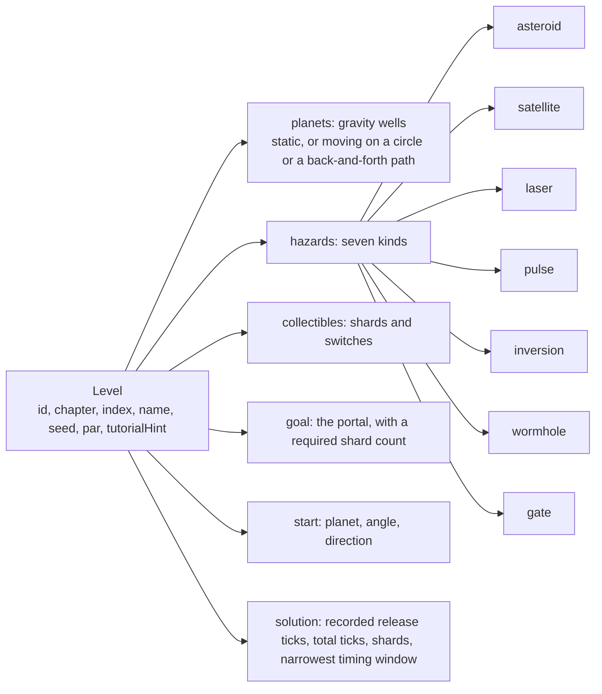

The contract is `src/game/levels/types.ts`. `buildRuntime(level)` prepares a level for stepping: it sorts hazards by family
and indexes planets and collectibles by id.

A collectible is either a `shard` (counts toward the portal and the totals) or a `switch` (only opens gates). The type and
the simulation support both. **No shipped level uses a switch**; all 120 use shards.

### 4.3 The ship's state machine

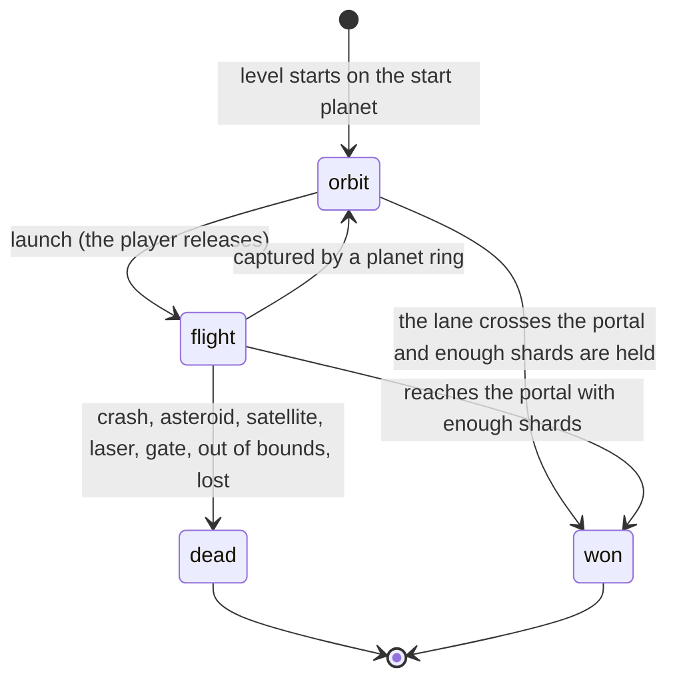

An orbiting ship is **invulnerable**: the dashed lane is a safe surface, so waiting is never punished. The ship can only
die in flight.

### 4.4 One simulation step

`stepSim(rt, state, launch)` advances exactly 1/60 s and mutates `state`. The order is fixed so collisions are predictable.

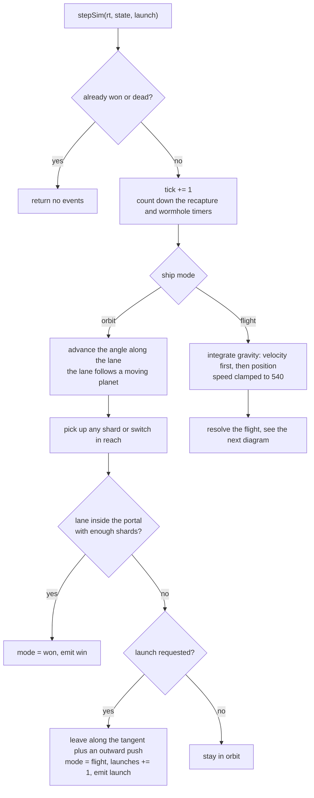

**Orbiting.** The angle advances by `dir * orbitSpeed / laneRadius` radians per second. Smaller planets therefore spin the
ship faster. The ship's position is recomputed from the planet's position at that tick, so a moving planet carries its lane
with it.

**Launching.** The launch direction is the lane tangent plus `0.34` of the outward radial direction, normalised and scaled
to speed 340. A moving planet's own velocity is added, so you inherit its drift. The planet you left becomes the "grace"
planet for 36 ticks.

### 4.5 Resolving a flight step

The order below is what makes outcomes predictable. For example, a lethal hazard is checked before a pickup, so you cannot
grab a shard on the same tick that kills you.

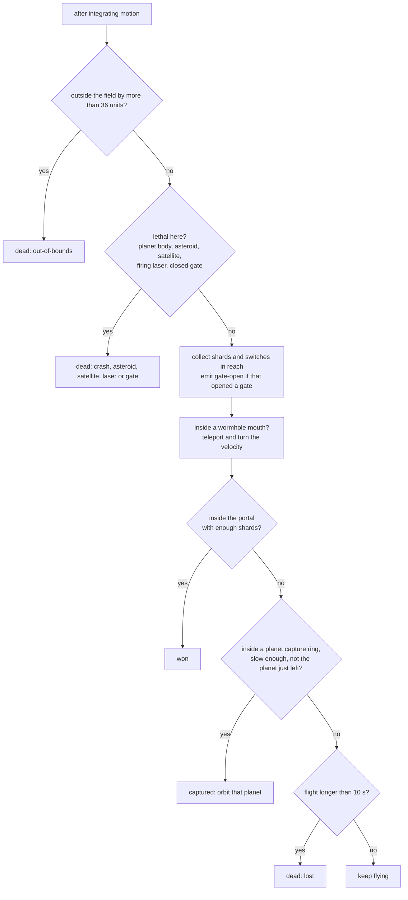

### 4.6 Gravity

Gravity is **arcade, not n-body**. Each planet pulls the ship toward its centre with a magnitude of
`gravity * (1 - d / influence)^2`, where `d` is the distance. That is exactly zero at the planet's influence radius and
finite at its centre, so nothing is singular and nothing reaches across the whole level. Integration is semi-implicit Euler
at 1/60 s, and speed is clamped to 540.

Two other effects add to the same acceleration:

- **Inversion zones** flip the sign of *every* planet's pull while the ship is inside the zone.
- **Active pulses** push the ship outward from their emitter, strongest at the emitter and fading to zero at the radius.

### 4.7 The hazard families

| Hazard | Behaviour | Lethal | Timing |
|---|---|---|---|
| **Asteroid** | A fixed rock. The jagged outline is seeded per rock and purely visual. | On touch, within its radius plus 7 | None |
| **Satellite** | Circles a planet (and follows it if the planet moves) or a fixed point. Position is a function of the tick. | On touch, within its radius plus 7 | Continuous |
| **Laser arc** | A rotating sector between an inner and an outer radius, with an angular width. | Only while firing | Shared cycle: warn, on, off |
| **Repulsion pulse** | An emitter that shoves the ship outward within a radius. | No, it only pushes | Same cycle as the laser |
| **Inversion field** | A zone where planetary pull becomes push. | No | None |
| **Wormhole** | A pair of mouths. Enter one and leave by the other, with the velocity turned and scaled. | No | 24-tick cooldown on exit |
| **Shield gate** | A barred segment. It stays shut until every collectible it names is collected. | While closed | Opens permanently |

**The warn, on, off cycle.** Lasers and pulses share one rule: with `t = tick % period`, the first `warn` ticks are the
*warning* (harmless, drawn as a dashed outline), the next `on` ticks are *firing* (drawn solid), and the rest of the period
is *off*. The level validator requires a warning of at least half a second (30 ticks) and a firing phase of at least a third
of a second (20 ticks).

**Moving planets** use one of two closed-form paths: `orbit` (a circle: `angle = phase + omega * t`) or `ping` (a smooth
back-and-forth between two points using `0.5 - 0.5 * cos(2 * pi * (t / period + phase))`).

**Wormholes.** On entering mouth `a`, the velocity turns by `rotate` radians and its speed is multiplied by `speedScale`.
Entering mouth `b` does the reverse (the opposite turn and the speed divided by `speedScale`). The ship reappears just
outside the other mouth, moving along the new heading.

**Shards, gates and the portal.** A portal needs `requiredShards`. Until the ship holds that many shards the portal is
inert. In the generator, each required shard comes with a gate that sits later on the route and opens when that shard is
collected.

### 4.8 Capture

A planet captures the ship when, in this order: it is not the grace planet, the ship is within the capture ring, and its
speed *relative to the planet* is at most 470. On capture the ship snaps to the lane, its velocity is cleared, and its
direction is chosen from the sign of `dx * rvy - dy * rvx`, so it keeps circling the same rotational way it was approaching.

### 4.9 Time and determinism

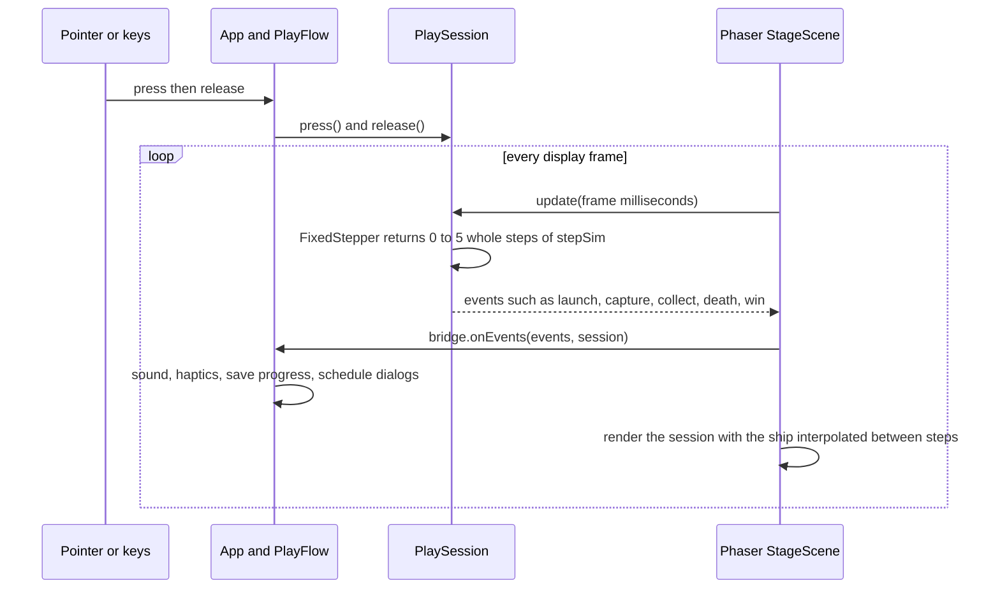

- `FixedStepper` turns variable frame times into **whole fixed steps**. The simulation advances at 60 Hz of *game time*
  on a 30, 60, 120 or 144 Hz display alike. A long stall is capped at 5 steps, so the game slows down instead of
  fast-forwarding.
- The renderer interpolates the leftover fraction (`alpha`) in `ship-view.ts`: flights by velocity, orbits analytically.
  Rendering never feeds back into the simulation.
- Time on the HUD and in star ratings is **game time** (ticks / 60), so pausing never costs a star.

### 4.10 The aiming preview

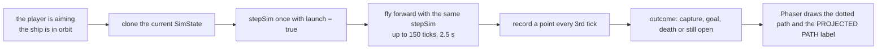

Because the preview runs the real `stepSim` on a copy of the real state, it includes every pull, hazard and moving planet.
A test compares real flight positions with preview points to 9 decimal places, including with moving planets and an
orbiting satellite. The preview is cached per tick, so the path sweeps around as the ship moves along its lane.

### 4.11 Stars

| Stars | Condition |
|---:|---|
| 1 | Clear the level |
| 2 | Clear it within the level's **par launches** |
| 3 | Also finish within the level's **par seconds** (game time) |

The generator sets par launches to the verified route's launch count plus 1 (plus 2 in chapters 1 and 2), and par seconds to
`ceil(route seconds x 1.7 + 6)`. The recorded route always earns three stars; the audit enforces it.

### 4.12 Replay

`replayLaunches(rt, launchTicks)` runs a level from the start and releases on the recorded ticks. A tick in `launchTicks`
is the value of `state.tick` *after* the step in which the player released. Replay is bit-for-bit repeatable, which is what
lets a level store its own winning route.

---

## 5. A play session and the input state machine

`PlaySession` (`src/game/session.ts`) is one attempt at one level. It owns the simulation state, the fixed-step clock and
the aim and launch input. It knows nothing about Phaser or the DOM.

Two control modes exist (Settings, "Controls"):

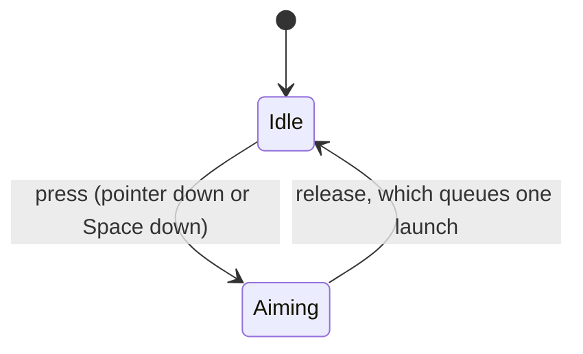

Hold mode (default).

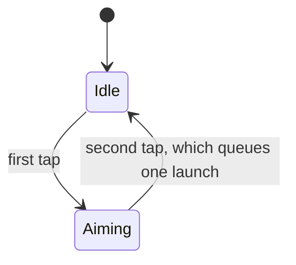

Tap-twice mode.

Other behaviour of `PlaySession`:

- A queued launch is consumed by the next simulation step, and only if the ship is in orbit then.
- `pause()` clears aiming and any queued launch. `resume()` drops the partial step so paused time is never replayed.
- `restart()` builds a fresh initial state and resets the clock, preview cache and flags.
- `completion()` returns what to record after a win (level id, stars, ticks, launches, shards), or `null`.
- `autopilot` replays a recorded solution. It is a development and testing tool; normal play leaves it `null`.

---

## 6. The application layer: routes, play flow, dialogs, keys

`App` (`src/app/app.ts`) wires storage, sound, screens and the playfield together. It implements `UiActions`, the only
interface screens use to ask for anything.

### 6.1 Screens and navigation

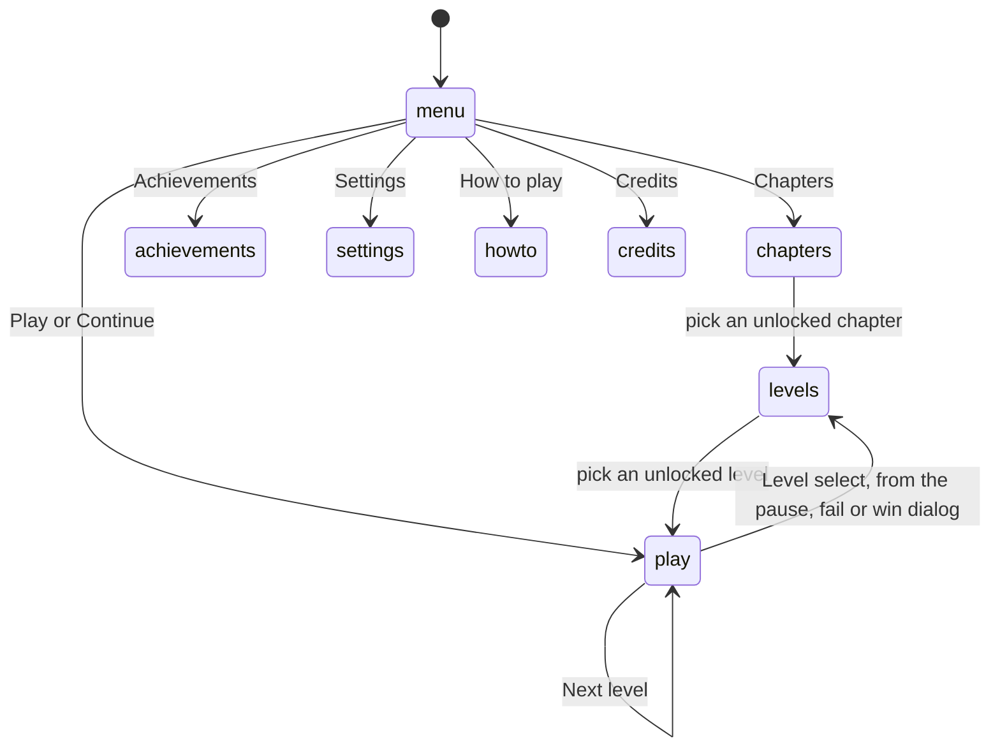

`Route` is a union of `menu`, `chapters`, `levels`, `settings`, `howto`, `achievements`, `credits` and `play`. `go()` pushes
the current route onto a history stack unless you are in play. Opening Settings *during* a level shows it as a dialog
instead of a route, so the level stays where it is.

**Unlocking** is strictly sequential. Level *n* is open when levels 1 to *n-1* have all been cleared, which is
`unlockedUpTo` in `progress-model.ts`. A chapter is open when its first level is. "Continue" starts the first unfinished
level.

### 6.2 What "back" does

The same `back()` serves the on-screen Back control, Escape and the Android back button.

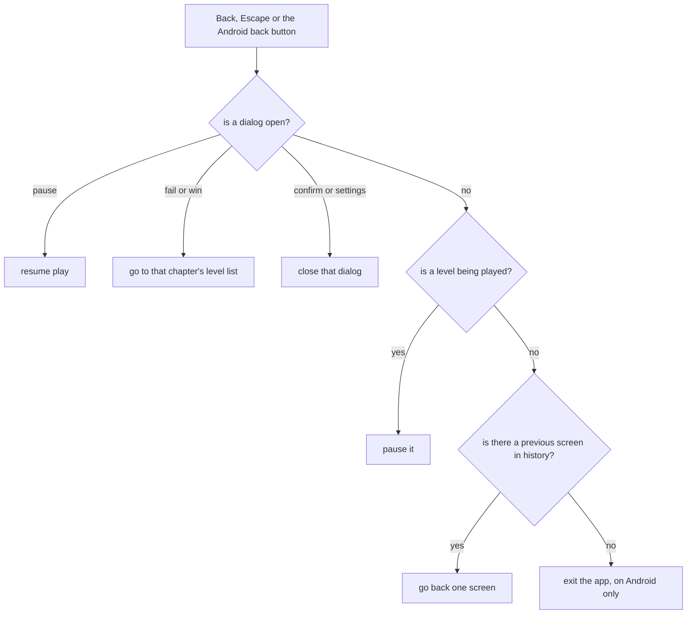

### 6.3 `PlayFlow`: one level at a time

`PlayFlow` (`src/app/play-flow.ts`) starts a level, reacts to what happens in it, saves the result and offers what comes
next. The stage reports each frame's events through `bridge.onEvents`, and `PlayFlow` turns them into feedback:

| Event | Sound | Haptic | Other |
|---|---|---|---|
| `launch` | launch | light | Marks the tutorial done and dismisses the hint |
| `capture` | capture | light | |
| `collect` | shard | light | |
| `gate-open` | gate | medium | |
| `teleport` | teleport | light | |
| `death` | fail | heavy | Counts a death, opens the fail dialog after 650 ms (250 ms with reduced motion) |
| `win` | win | success | Saves at once, opens the win dialog after 800 ms |

The Phaser stage reacts to the same events with its own visuals: a particle burst and a ring on capture, a gold burst on a
pickup, a violet burst on a teleport, a coral burst plus a short camera shake on death, a burst and a small zoom on a win.
With reduced motion the shake and zoom are skipped and particle counts are halved.

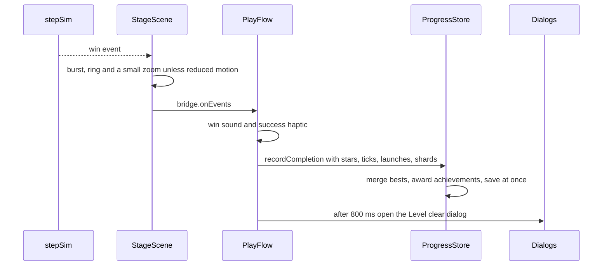

The result is **saved the instant the level is won**, before the celebration delay, so even a process kill during it keeps
the clear.

### 6.4 Dialogs and keys

- `DialogStack` tracks the kind of the topmost dialog (`pause`, `fail`, `win`, `confirm`, `settings`). That is how Back,
  Escape and the Android back button each do the right thing.
- The fail dialog puts **Retry first and already focused**, so Enter or Space starts the next attempt at once.
- Keyboard: **Space** aims and launches, **P** and **Escape** pause, **R** restarts, **M** mutes. Menus and dialogs keep their
  normal keys (Tab, Enter, arrows) and Tab stays inside an open dialog. While the playfield is live, Space is swallowed so
  it cannot scroll the page or click a focused button.
- Keys are ignored while typing in a text input, and when Ctrl, Meta or Alt is held.

### 6.5 Settings and lifecycle

Changing a setting runs `SettingsStore.update`, which sanitises, saves and notifies listeners. `App.applySettings` then
updates the page (`data-contrast`, `data-motion`, the CSS colour variables), the audio levels, the renderer's preferences
and the current session's control mode.

The **lifecycle** adapter reports "background", "foreground" and "back". In a browser it uses `visibilitychange` and
`pagehide`; in the Android app it also uses Capacitor's `appStateChange` and `backButton`. Going to the background pauses
the level and suspends audio. Coming back resumes audio only, so the player chooses when to continue.

---

## 7. Rendering: Phaser canvas plus a DOM overlay

### 7.1 Two renderers, one rectangle

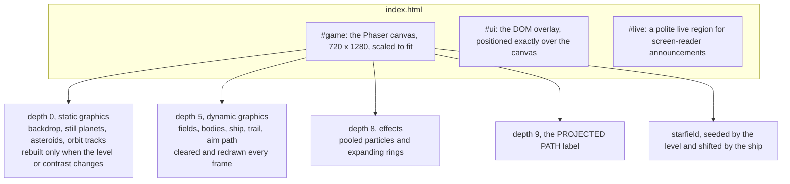

Phaser creates the canvas after the page loads and repositions it with margins. A `ResizeObserver` alone does not report
that, so `trackCanvas` combines a `ResizeObserver`, a `MutationObserver`, `resize` and `orientationchange` listeners and a
250 ms poll to keep the DOM overlay pixel-aligned with the canvas. An end-to-end test asserts the two rectangles match on
phone, tall-phone and desktop viewports.

The Phaser game is configured with the `AUTO` renderer, `Scale.FIT` centred, Phaser's own audio switched off (sound is
synthesised in `src/audio`), two active pointers and a single scene, `StageScene`.

### 7.2 The bridge

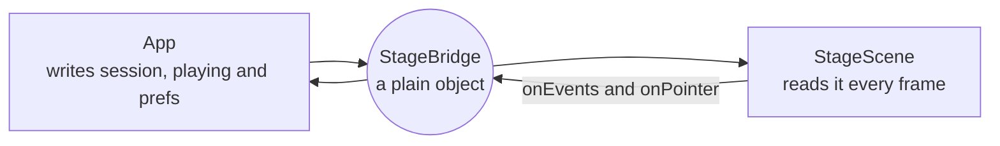

The bridge holds the session to draw, whether a real level is on screen, the render preferences (reduced motion, high
contrast) and two callbacks. It is a plain object so that neither side needs to know how the other is built.

When the menu is showing there is no level, so the stage draws an **attract scene** (`ATTRACT_LEVEL`): a ship circling a
planet while a second planet drifts and the portal glows. It is not in the catalogue, has no hazards, and the app ignores
pointer presses while it is shown.

### 7.3 The DOM layer

`UiLayer` owns the DOM that sits over the playfield: one current screen (or the HUD), a stack of modal dialogs, toasts and
the live region. While a dialog is open everything beneath it is `inert`, Tab is trapped inside it, and focus returns to
what opened it when it closes. Screens are built with a tiny helper, `h()`, and are plain functions of a `UiContext`.

The HUD is one slim row, so it never covers a portal: pause, level, shards (only when the level has any), launches (with
par) and time. Each short chip carries a visually hidden label for screen readers.

### 7.4 Visual language

The palette (`src/ui/palette.ts`) is one source of truth for the CSS variables and the Phaser colours. Each accent carries
one meaning:

| Token | Meaning |
|---|---|
| amber | The ship and primary actions |
| teal | Safe orbit, the portal, success |
| coral | Lethal hazards, failure |
| gold | Shards and stars |
| violet | Gravity inversion and wormholes |
| ice blue | Repulsion pulses |

Colour is **never the only signal**: asteroids are jagged, satellites have panels, lasers are a dashed outline that turns
solid when firing, gates are barred posts, wormholes are spirals, pulses are contracting rings with outward arrows, and a
locked portal shows a padlock. A separate high-contrast palette exists, and `tests/palette.test.ts` asserts the WCAG contrast
of every text and background pair in both. Fonts are Instrument Serif, Instrument Sans and IBM Plex Mono, bundled locally.

### 7.5 Accessibility, in one place

Real DOM controls with keyboard support; a focus trap and `inert` background in dialogs; a polite live region; labelled
controls; a high-contrast palette; reduced motion (the setting defaults to the system preference); 44 px minimum targets;
layouts that hold from 320 px wide. The canvas is exposed as an image with the label "Orbit Shift playfield". A canvas game
cannot be played by screen reader: menus, results and announcements work with one, but the flight itself is visual.

---

## 8. Storage: saves, settings, progress

### 8.1 Two saves, one mechanism

Settings (`orbit-shift.settings`) and progress (`orbit-shift.progress`) are each a `SaveSlot`: a versioned envelope with a
rolling backup. Both are currently at version 1, with an identity migration.

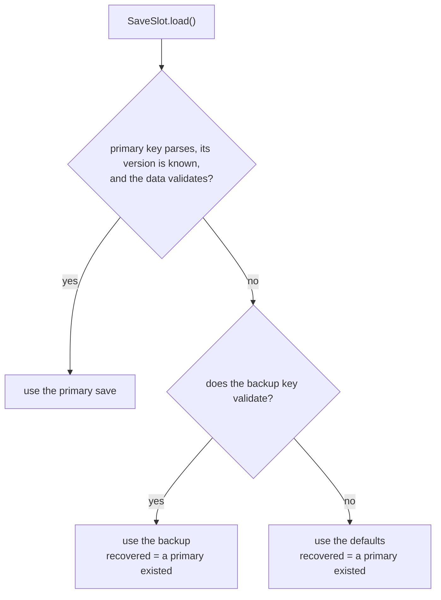

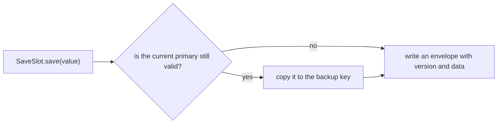

A save from a **newer** version than the code is refused, an older one is migrated, and a blocked or full store returns
`false` from `set` without crashing. When the **progress** save was recovered from its backup or from defaults, the app
shows a toast. A backup is only taken from a primary that is itself valid, so a corrupt save never overwrites a good backup.

### 8.2 What is saved

| Slot | Contents |
|---|---|
| Settings | Music and effects volume, mute, haptics, reduced motion, high contrast, control mode (`hold` or `tap`) |
| Progress | Per-level record (stars, best ticks, best launches, best shards), unlocked achievements with timestamps, lifetime stats (restarts, deaths, launches), last level opened, whether the tutorial is done |

Both are validated **field by field**: one bad field falls back to its default instead of discarding every other setting.

### 8.3 Recording a clear

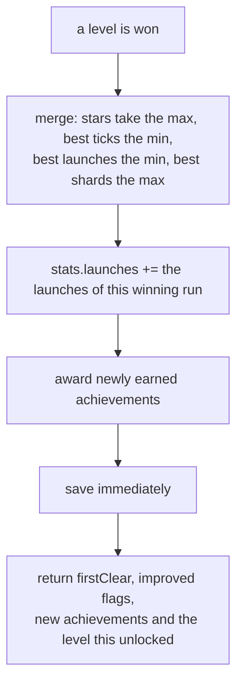

Each best is kept **separately**, so a worse replay never erases a better earlier one. The "NEW BEST" badge on the win
dialog comes from the `improved` flags and is not shown on a first clear.

One detail that matters if you build on these stats: `stats.launches` is only increased when a level is **won**, so it counts
launches from winning runs, not every launch ever made. `stats.deaths` and `stats.restarts` are counted as they happen.

---

## 9. Audio and haptics

- **No audio files.** Every effect and the background music are generated with the Web Audio API, so there is nothing to
  license, download or bundle.
- `AudioEngine` creates its `AudioContext` lazily on the first user gesture (browsers refuse earlier), with a master gain and
  two buses, one for effects and one for music. Until then every call is a quiet no-op. Volume changes ramp instead of
  jumping, to avoid clicks. A context the system suspends is resumed the next time the game asks.
- `Sfx` has eleven named voices built from oscillators and filtered noise: `launch`, `capture`, `shard`, `gate`, `teleport`,
  `fail`, `win`, `click`, `back`, `pause`, `star`.
- `Music` is generative: a soft triangle-wave pad that changes chord every 8 seconds over four slow chords, plus sparse
  sine "bells" from a pentatonic scale. A look-ahead scheduler (1.2 s) queues notes slightly early so timing stays accurate
  when the JavaScript thread is busy. Its random choices use a small seeded generator, so it is repeatable.
- **Haptics** use the Capacitor Haptics plugin on Android and `navigator.vibrate` on the web, and do nothing where neither
  exists. Four kinds: light, medium, heavy and success. They respect the player's Haptics setting, and any failure is
  swallowed because feedback must never interrupt play.

---

## 10. Levels: data, generator, solver, audit

### 10.1 The shape of the content

The 120 levels are typed TypeScript data in `src/game/levels/data/chapter-NN.ts`, each exporting a `Level[]`. The compiler
checks the shape. `LEVELS` in `catalog.ts` concatenates them in play order. Each level stores its recorded winning route
(`solution.launchTicks`), so anyone can replay it.

Chapters 1 to 9 each teach one idea, and chapters 10 to 12 mix them:

| Ch. | Name | New idea | Minimum timing window |
|--:|---|---|---:|
| 1 | First Orbit | Launch, capture, portal | 12 ticks, 200 ms |
| 2 | Twin Suns | Several wells; asteroids from level 5 | 12 ticks, 200 ms |
| 3 | Satellite Alley | Orbiting hazards and timing | 10 ticks, 167 ms |
| 4 | Laser Observatory | Warning phase, rotating beams | 8 ticks, 133 ms |
| 5 | Wandering Worlds | Moving planets | 8 ticks, 133 ms |
| 6 | Reverse Gravity | Inversion zones | 8 ticks, 133 ms |
| 7 | Pulse Fields | Repulsion timing | 6 ticks, 100 ms |
| 8 | Folded Space | Wormholes | 6 ticks, 100 ms |
| 9 | Locked Constellations | Shards and gates | 6 ticks, 100 ms |
| 10 | Orbital Machines | Mixed hazards | 5 ticks, 83 ms |
| 11 | Starship Trials | Longer, efficient routes | 5 ticks, 83 ms |
| 12 | Event Horizon | Everything at once | 5 ticks, 83 ms |

### 10.2 Why a generator, and what "proven" means

120 levels cannot be hand-balanced in one pass, and "authored" must not mean "unchecked". So levels are **composed by a
seeded generator** and accepted only if a solver proves a winning route exists with comfortable timing. This proves that
every level is *beatable and replayable*. It does **not** prove a level is fun, fair or readable to a person; that is
tracked separately (see section 15).

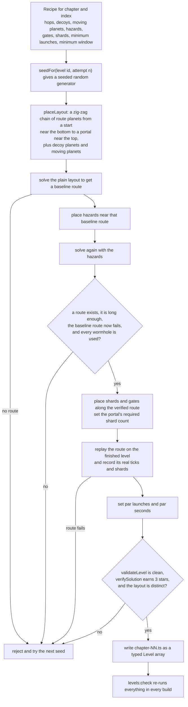

The generator tries up to **160 seeds** per level. When a recipe cannot be satisfied it prints *why* candidates were thrown
away (for example "no room to place a hazard" or "hazards change nothing"), counted by reason. Levels with no hazards, such
as most of chapter 1, skip the two hazard steps and use the baseline route directly.

The **recipe** (`scripts/levels/generator/recipes.ts`) is a pure function of the chapter and the index within it. It decides
the number of route planets ("hops": 1 for level 1, otherwise 2 to 6), decoys, moving planets, the hazards, how many gates,
and the minimum launches and timing window. A layout is deterministic for a given seed, so a level's `seed` field
reproduces it.

### 10.3 The solver

`src/game/tools/solver.ts` is a **breadth-first search over release ticks**. It lives in `src/game` so tests can use it, but
the running game never calls it.

```mermaid
flowchart TB
  N["a node: the ship in orbit on a planet,<br/>after the launches chosen so far"] --> W["for each wait tick, up to one orbit lap<br/>at least 300 ticks if anything moves, at most 480"]
  W --> P["probe: clone the state, release now,<br/>and fly until the flight ends"]
  P --> Q{"does it end in the goal<br/>or in a capture?"}
  Q -->|"no: death or lost"| D["discard this release tick"]
  Q -->|"yes: key is the goal or a planet id"| G["group consecutive ticks with the same key into runs"]
  G --> F{"is the run at least minWindow ticks long?"}
  F -->|no| D
  F -->|yes| C["candidate: release at the middle of the run,<br/>its window is the run length"]
```

The key idea is the **window**. A launch only counts when a run of *consecutive* release ticks all end the same way. So no
required move is a one-frame trick: if the recipe asks for a 6-tick window, a player may release up to a few ticks early or
late and still land the same shot.

```mermaid
flowchart TB
  D1["depth 1: expand the start node"] --> Z{"any candidate reaches the goal?"}
  Z -->|yes| BEST["return the goal route with the widest narrowest-window<br/>this is the fewest-launch route found"]
  Z -->|no| DEDUP["drop states already seen:<br/>same planet, same collected set, same time bucket"]
  DEDUP --> SORT["sort by distance to the portal and keep the best few<br/>the beam: 30 in the generator"]
  SORT --> NEXT["next depth: expand each kept node"]
  NEXT --> Z
```

The generator searches to at most 8 launches with a budget of 500 nodes. Because the search keeps only a beam of promising
nodes, "no solution found" does not mean a layout is unsolvable. That is acceptable because a level is only *accepted* when
a route has been found **and** replayed on the finished level.

### 10.4 The audit that runs in every build

`npm run levels:check` (also the first step of `npm run build`, so a broken level cannot ship) runs `auditLevels`:

```mermaid
flowchart TB
  A["auditLevels over all levels"] --> A1["counts: 120 levels and 12 chapters"]
  A --> A2["each level, in order: runtime schema,<br/>validateLevel, verifySolution"]
  A --> A3["distinctness: unique names, unique layouts,<br/>similarity below 0.55"]
  A --> A4["chapters: 10 levels each, at least 7 distinct<br/>mechanic combinations, the themed hazard present"]
  A --> A5["families: all eight mechanic families used somewhere"]
  A1 --> R{"any problem?"}
  A2 --> R
  A3 --> R
  A4 --> R
  A5 --> R
  R -->|yes| F["exit code 1: the build stops"]
  R -->|no| OK["Catalogue OK"]
```

- **Schema** (`schema.ts`, zod) is a development and CI tool, never in the game bundle. Typing it as `z.ZodType<Level>` makes
  the compiler prove the schema and the TypeScript type describe the same shape.
- **`validateLevel`** checks geometry: planet sizes, gravity and orbit-speed ranges, nothing overlapping a planet's keep-out
  zone, moving things staying in the field (sampled over 600 ticks), the goal's distance from the start, hazard timing
  minimums, gate and wormhole geometry, collectibles not sitting inside planets, rocks or satellite paths, and par being
  achievable by the recorded route.
- **`verifySolution`** replays the recorded route through the real simulation and requires a win with the recorded tick
  count, launch count and shard count, earning exactly three stars.
- **Distinctness.** Two layouts are "alike" when the Jaccard similarity of their occupied 60-unit grid cells is 0.55 or more.

The same command prints how difficulty is meant to rise. This is its output on 2026-11-05:

| Chapter | Mean launches | Mean planets | Mean hazards | Mean window (ms) | Mechanic combinations |
|---|---:|---:|---:|---:|---:|
| 1 First Orbit | 2.4 | 3.4 | 0.0 | 218 | 8 of 10 |
| 2 Twin Suns | 3.0 | 5.3 | 0.8 | 245 | 9 of 10 |
| 3 Satellite Alley | 2.7 | 3.7 | 2.2 | 207 | 9 of 10 |
| 4 Laser Observatory | 2.8 | 4.5 | 1.6 | 175 | 7 of 10 |
| 5 Wandering Worlds | 2.8 | 4.6 | 0.5 | 143 | 10 of 10 |
| 6 Reverse Gravity | 2.7 | 4.7 | 1.6 | 187 | 8 of 10 |
| 7 Pulse Fields | 2.7 | 4.6 | 1.6 | 155 | 7 of 10 |
| 8 Folded Space | 3.0 | 5.6 | 1.4 | 128 | 9 of 10 |
| 9 Locked Constellations | 3.0 | 5.6 | 2.4 | 132 | 9 of 10 |
| 10 Orbital Machines | 3.0 | 5.5 | 2.7 | 117 | 10 of 10 |
| 11 Starship Trials | 3.1 | 5.4 | 3.0 | 117 | 10 of 10 |
| 12 Event Horizon | 3.0 | 6.1 | 4.1 | 115 | 10 of 10 |

The timing window narrows from about 245 ms in chapter 2 to about 115 ms in chapter 12, while planets and hazards increase.
"Mean launches" is the length of the *recorded* route, which is the fewest-launch route the solver found, not a limit on the
player.

### 10.5 Human verification is a separate column

`npm run levels:qa` writes `docs/LEVEL_QA.md`, one row per level, with automated results computed from the data. The
"played by a person" column comes only from `qa/manual-playthroughs.json`, which **only a person edits**. The script never
invents a "passed". As of this writing, 0 of 120 levels have been played by a person.

---

## 11. Android

### 11.1 Building the APK

`npm run android:apk:debug` runs `scripts/build-apk.mjs`:

```mermaid
flowchart TB
  C["npm run android:apk:debug"] --> S1["1 of 4: npm run build<br/>levels:check, tsc, then vite build into dist"]
  S1 --> S2["2 of 4: cap sync android<br/>copy dist into the Android project"]
  S2 --> J["find JDK 21 or newer and the Android SDK<br/>write android/local.properties"]
  J --> S3["3 of 4: Gradle assembleDebug"]
  S3 --> S4["4 of 4: check the APK exists, is at least 100,000 bytes,<br/>and that aapt2 reads the expected package id<br/>and a versionName matching package.json"]
  S4 --> O["copy to artifacts/OrbitShift-VERSION-debug.apk<br/>and write a .sha256 file"]
```

Because the web build is step 1, **the APK can never package stale assets**. The version comes from `package.json`:
`versionName` is the package version and `versionCode = major x 10000 + minor x 100 + patch` (1.0.0 becomes 10000).

### 11.2 How it runs

```mermaid
flowchart LR
  APK["the APK"] --> ACT["MainActivity<br/>extends BridgeActivity"]
  ACT --> WV["a WebView at https://localhost/<br/>serving the bundled dist"]
  WV --> GAME["the same JavaScript bundle as the browser"]
  GAME <-->|"back button, app state"| CAPA["Capacitor App plugin"]
  GAME -->|"impact, notification"| CAPH["Capacitor Haptics plugin<br/>VIBRATE permission"]
```

- There is **no `server.url`**: the app never loads a remote page, and works in airplane mode. `vite.config.ts` sets
  `base: './'` so asset URLs are relative, because the WebView serves the bundle from its own origin.
- The manifest declares **no permissions** (so no `INTERNET`). The Haptics plugin contributes `VIBRATE` by manifest merging.
- The activity is portrait-locked and `singleTask`. System bars are always dark-style, because the game is always dark.
- The package id is `com.portfolio.orbitshift`. The deliverable is a **debug-signed** APK for sideloading. There is no
  release signing, no `.aab` and no Play Store setup. Updating in place keeps saved progress only when the new APK is signed
  with the same key.

### 11.3 Checking it on a device

`npm run android:verify` (`tests/android/verify.mjs`) installs the APK on an emulator or phone, attaches to the app's WebView
through its DevTools socket with a small Chrome DevTools Protocol client, and also sends real device input (taps, a held
touch, back, Home, airplane mode). `ORBIT_ADB_SERIAL` is required so it can never touch some other connected device.

---

## 12. Quality system: tests, lint, CI

```mermaid
flowchart TB
  subgraph Fast["Fast: locally and in CI"]
    direction LR
    A["levels:check"] --> B["tsc --noEmit"]
    B --> C["eslint with the limits"]
    C --> D["vitest, 90 percent coverage gate"]
    D --> E["vite build"]
  end
  subgraph Local["Run locally only"]
    direction LR
    F["test:e2e: Playwright, Edge or Chrome"]
    G["android:verify: emulator or phone"]
  end
  Fast ~~~ Local
```

### 12.1 Layers of testing

| Layer | Tool | What it covers |
|---|---|---|
| Unit and integration | Vitest in node (13 of the 15 test files) | Simulation, hazards, solver, levels, storage, audio, platform, session |
| UI and application | Vitest in jsdom (the other 2: `app.test.ts` and `ui-core.test.ts`) | Screens, dialogs, navigation and the whole play flow against fakes |
| Browser | Playwright against a running server | Real mouse, touch and keyboard input, axe WCAG 2.2 AA on every screen, phone layouts, 44 px targets, persistence, no-network play, and all 120 recorded solutions winning in the live game |
| Device | `tests/android/verify.mjs` | Tap and hold, back and Home, progress surviving a process kill, airplane mode, in-place update |

The app is testable without Phaser or a browser because of how it is built. `tests/helpers/app-rig.ts` assembles a real
`App` with a memory store, a fake `AudioContext`, a fake lifecycle and a mock haptic backend, and offers `frame(ms)` as a
stand-in for the Phaser stage.

The browser tests use `window.__orbit` (the development inspector) to read state and fast-forward. That hook is not in the
production bundle, so those tests are skipped against a production build by design.

Coverage is gated at 90 percent for lines, statements, branches and functions. Three things are excluded, each covered by
the browser suite instead: `src/phaser/**` (it needs a real WebGL canvas), `src/main.ts` (the entry point) and
`src/app/dev.ts` (the dev inspector). The generated level data is excluded too. These exclusions are stated in
`vite.config.ts`.

### 12.2 Lint limits that are enforced

`npm run lint` fails on: lines over 120 characters, more than 4 parameters, nesting deeper than 3, cyclomatic complexity over
10, cognitive complexity over 15, functions over 60 lines, files over 400 lines, `console` calls, `any` and non-null
assertions. The generated level data is exempt from the file-length rule only. Level tooling in `scripts` may print to the
terminal on purpose.

### 12.3 CI

`.github/workflows/ci.yml` runs on every push and pull request: `npm ci`, level check, typecheck, lint, tests with coverage,
and the production build. It does not run Playwright or the Android checks, which need a browser or a device. **This
workflow has been written but has never been run on GitHub.**

---

## 13. How it was built, and why

This section is drawn from what the repository records: [`FEATURE_LOG.md`](../FEATURE_LOG.md),
[`ADR-0001`](ADR-0001-stack-and-design.md) and [`DESIGN-REFERENCES.md`](DESIGN-REFERENCES.md). It does not reconstruct an
order of work that the repository does not record.

### 13.1 The brief

The owner asked for a complete, original, offline game for the browser and Android, with the same polish as the sibling
project SkyHop, built to a rulebook with engineering, accessibility and honesty rules. The technical brief was: Phaser 3,
TypeScript, Vite and Capacitor; a deterministic fixed-step simulation; WCAG 2.2 AA; and original art and sound with no hosted
dependencies. Orbit Shift was created from scratch as a new repository next to SkyHop. SkyHop was read for reference only and
was not modified. Its dev port is 5605 and this project uses 5610, so both can run at once.

The first implementation is recorded on **2026-11-03** as one entry in `FEATURE_LOG.md`.

### 13.2 The decisions and what each cost

| Decision | Reason | Consequence |
|---|---|---|
| **Phaser 3.90.0, pinned** (not Phaser 4) | `npm view phaser` reports 4.x as `latest`, but the brief says Phaser 3 | Moving to Phaser 4 is a separate, deliberate migration, not something picked up by a caret range |
| **DOM for menus, canvas for the playfield** | A canvas has no focus, no screen-reader tree and no text zoom, and axe-core can only audit a DOM | Two renderers must agree on geometry, hence `trackCanvas` and a test that asserts the rectangles match |
| **Pure deterministic simulation** | The preview must equal the real flight, and a level's solution must replay exactly | Time is an integer tick and everything moving is closed-form in the tick |
| **Arcade gravity, not n-body** | Bounded forces are predictable and solvable | Each pull is `g * (1 - d/R)^2` with no singularity |
| **Levels as data, solver-proven** | 120 levels cannot be hand-balanced in one pass, and "authored" must not mean "unchecked" | Recorded solutions replay in every build, so changing physics breaks the build until levels are regenerated |
| **Synthesised sound** | No files to license, download or bundle, and a smaller APK | The sound is only as good as the synthesis, and has not been heard on a phone speaker |
| **`localStorage` with a rolling backup** (not Capacitor Preferences) | Preferences would add an async boot and a second code path for persistence the WebView already provides | The Android checks confirm progress survives a process kill and an in-place update |
| **Capacitor 8, one bundle, no `server.url`** | One shared codebase, fully offline | A debug-signed APK for sideloading only |

Rejected alternatives recorded in the ADR: Phaser-native menus (not accessible) and React (not needed, and the brief asked
to avoid it without a reason).

### 13.3 Design research

The rulebook asks for three real references to be opened before a new UI is built. Three were opened. Two returned almost
nothing usable and one gave a useful palette-by-role and contrast model. The research log records that honestly. The visual
direction came mainly from the brief: an "observatory" feel with dark midnight backgrounds, restrained luminous accents,
crisp orbit lines and legible geometric type. Two directions were compared, "Observatory" and "Neon arcade", and Observatory
was chosen because the playfield needs a calm, high-contrast ground so that hazards stand out.

### 13.4 The working rule: claims limited to what was run

The repository is built to separate three different statements that are easy to blur:

| Statement | Evidence it needs | Status |
|---|---|---|
| "The code is correct and the checks pass" | Typecheck, lint, tests, build | Re-run on 2026-11-05: typecheck and lint report no errors, and 278 tests pass across 15 files |
| "Every level has a winning route" | The audit replaying all recorded routes | `npm run levels:check` passes on all 120 |
| "A person can play it and it is good" | A person playing, on a real device | **Not done** |

### 13.5 A good order to read the code

This is a dependency order, not a history.

1. `src/game/levels/types.ts` and `simulation/constants.ts`: the vocabulary.
2. `simulation/step.ts`, then `forces.ts`, `collision.ts` and `encounters.ts`: the physics.
3. `simulation/flight.ts` and `session.ts`: preview, replay and one attempt.
4. `src/app/app.ts` and `play-flow.ts`: how the pieces are wired.
5. `src/phaser/stage-scene.ts` and `world-renderer.ts`, then `src/ui/screens/*`: what the player sees.
6. `src/storage/*`: saves and progress.
7. `scripts/levels/generator/*` and `src/game/tools/solver.ts`: how levels are made.

---

## 14. Making changes: recipes

### 14.1 Add a screen

Achievements is the smallest complete example.

1. Add the route to the `Route` union in `src/app/app.ts`.
2. Add an `openX()` method to `UiActions` in `src/ui/context.ts`, and implement it in `App` with `this.go({ name: 'x' })`.
3. Add a `case` in `App.screenFor`.
4. Write the screen as a function of `UiContext` in `src/ui/screens/`.
5. Add a button in `src/ui/screens/menu.ts`.
6. Add the screen to the navigation test in `tests/app.test.ts` and to the visit lists in `tests/e2e/screens.mjs`, which also
   runs the accessibility sweep. Check the menu still fits at 320 px wide.

### 14.2 Add a new hazard type

The hazard family touches many files by design, because each layer needs to know about it. Use a search for an existing
family (for example `pulse`) as your checklist. The places are:

| Area | File |
|---|---|
| Shape | `src/game/levels/types.ts` (the interface, the `Hazard` union, `HAZARD_TYPES`), `schema.ts` |
| Runtime | `src/game/simulation/runtime.ts` (a list and `buildRuntime`) |
| Behaviour | `forces.ts`, `collision.ts`, `encounters.ts` or `motion.ts`, as the hazard needs |
| Validation | `src/game/levels/validate.ts`, and `fingerprint.ts` for its short code |
| Audit | `src/game/levels/audit.ts` (`REQUIRED_FAMILIES`), `chapters.ts` if a chapter introduces it |
| Drawing | `src/phaser/draw/fields.ts` or `bodies.ts`, and `world-renderer.ts` |
| Teaching | `src/ui/screens/howto.ts`, which draws each hazard |
| Solver | `solver.ts` (`isDynamic`), if the hazard changes with time |
| Generator | `scripts/levels/generator/features.ts` and `recipes.ts` |
| Tests | `tests/simulation-hazards.test.ts` and the level tests |

### 14.3 Change physics or a tuned constant

Recorded solutions are replayed **bit for bit**, so changing any constant in `constants.ts`, or the gravity or collision
logic, can make recorded routes stop winning. `npm run levels:check` (and therefore `npm run build`) will then fail. Fix it by
regenerating the affected levels: `npm run levels:generate -- --chapter N`, then `npm run levels:check`, then
`npm run levels:qa`. The README estimates about 15 minutes to regenerate all 120 levels.

### 14.4 Add or change a level

Change the recipe in `scripts/levels/generator/recipes.ts` and regenerate that chapter, rather than hand-editing the
generated file. The generator reads the other chapters so a new level is checked for similarity against all of them.

### 14.5 Add a setting

Add the field to `Settings` and `defaultSettings` in `src/storage/settings.ts`, handle it in `sanitizeSettings`, add a row in
`src/ui/screens/settings.ts`, and react to it in `App.applySettings` if something must change live. Because settings are
validated field by field with defaults, adding a field does not need a version bump on its own. Bump `SETTINGS_VERSION` and
write a `migrate` only when an existing field changes meaning.

### 14.6 Cut a build

`npm run build` runs `levels:check`, `tsc --noEmit` and `vite build`. For Android, `npm run android:apk:debug` runs the build
first. See the README for requirements, install steps and the device-check command.

---

## 15. Limits of what has been verified

The README holds the authoritative table. In short:

- **No person has played the 120 levels.** Difficulty and fun are unproven; the QA manifest is the place to record results.
- **Not tested on a physical phone.** Touch feel, speaker audio, notches and real performance are unverified. The Android
  checks ran on an emulator.
- **No 60 FPS claim.** On the emulator's software graphics the game ran at 17 to 29 fps, which says nothing about a phone.
- **The CI workflow has never run** on GitHub.
- **Recorded solutions were verified on V8** (Node, Chrome, Android WebView), not on Safari's engine. `Math.sin` and
  `Math.cos` are engine-defined, so the last bits could differ elsewhere. The timing windows make that irrelevant to play,
  but the replay tests only run on V8.
- Generated layouts can look regular compared with hand-crafted ones.
- The web build has no service worker, so reloading it while offline needs the server. The APK is fully offline.

---

## 16. Glossary

| Term | Meaning |
|---|---|
| **Tick** | One simulation step, 1/60 of a second of game time |
| **Lane** | The dashed circle a ship orbits on, `planet radius + 28` from the centre. Nothing can hurt a ship on it |
| **Capture ring** | The lane radius plus 16. A slow enough ship that crosses it is captured |
| **Grace** | The 36 ticks after a launch during which the planet you left cannot recapture you |
| **Influence** | The distance at which a planet's pull fades to exactly zero |
| **Portal** | The goal. It stays inert until the ship holds the required number of shards |
| **Shard** | A collectible that counts toward the portal. Gates open when their shard is collected |
| **Par** | The launch count (2 stars) and seconds (3 stars) a level asks for |
| **Window** | How many consecutive release ticks produce the same result. A wider window is more forgiving |
| **Recipe** | The generator's description of one level: hops, decoys, hazards, gates, minimums |
| **Baseline route** | The solver's route on a layout before hazards are added |
| **Bridge** | The plain object the DOM app and the Phaser stage share |
| **Attract scene** | The slowly turning demo behind the menu. It is not a level |
| **Dev hook** | `window.__orbit`, present only on the dev server, used by browser tests |
